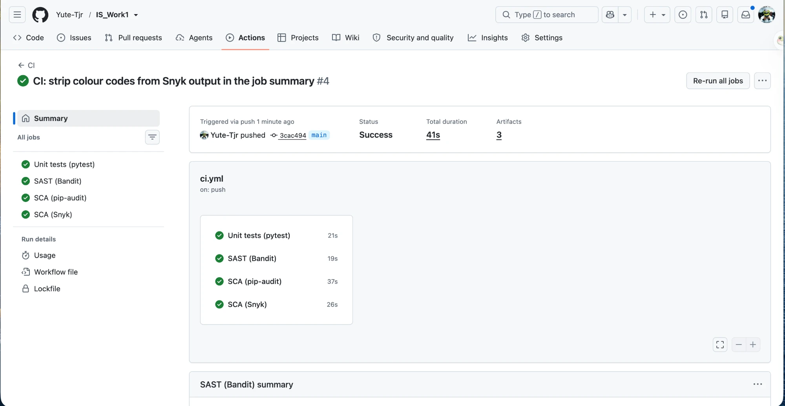
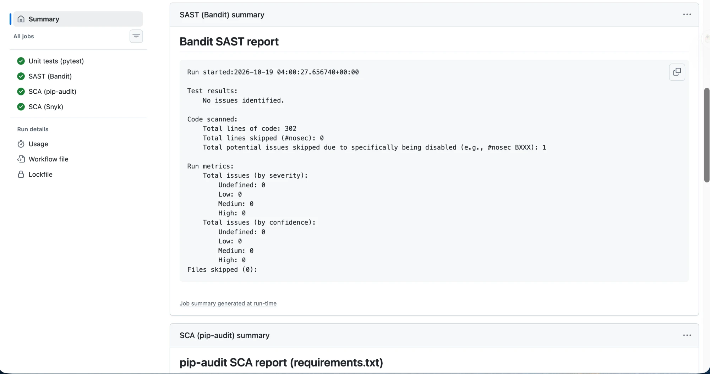
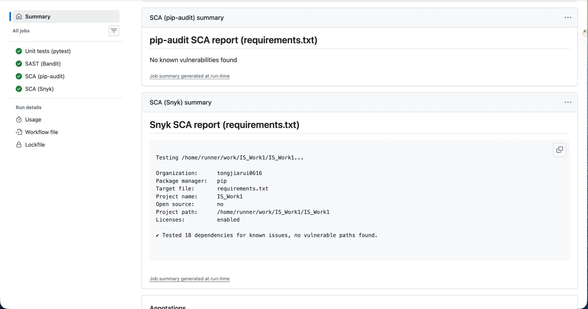
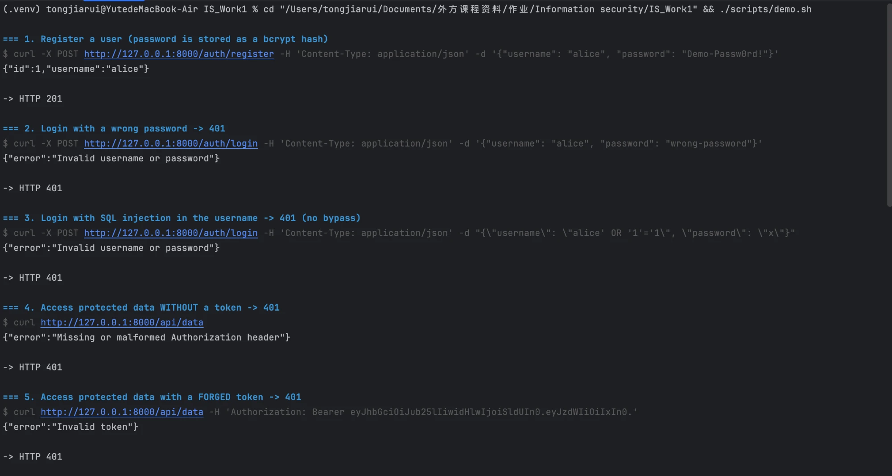
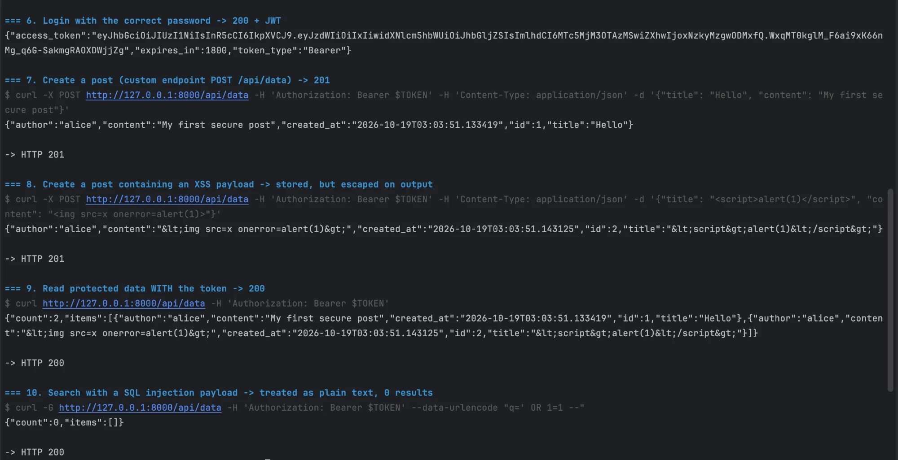

# Secure Notes API

[](https://github.com/Yute-Tjr/IS_Work1/actions/workflows/ci.yml)

Laboratory Work 1, Information Security (HDU): *Secure REST API Development with CI/CD and Real CVE Vulnerability Analysis*.

A small REST API written in **Python / Flask**. Authenticated users can publish and read short notes ("posts"). The project is built to defend against the OWASP Top 10 categories covered in the lab:

- A01:2021 Broken Access Control
- A03:2021 Injection (SQL injection and XSS)
- A07:2021 Identification and Authentication Failures

Every push and pull request runs the test suite, a SAST scan and an SCA scan in GitHub Actions.

| Component | Technology |
|---|---|
| Web framework | Flask 3.1 |
| Database | SQLite through SQLAlchemy ORM (Flask-SQLAlchemy) |
| Authentication | JWT (PyJWT, HS256) and bcrypt password hashing |
| Brute-force protection | Flask-Limiter |
| Tests | pytest (28 tests) |
| CI/CD | GitHub Actions with Bandit (SAST), Snyk and pip-audit (SCA) |

---

## 1. Project structure

```
.
├── app/
│   ├── __init__.py      # application factory, security headers, JSON error handlers
│   ├── config.py        # configuration (secrets are read from environment variables)
│   ├── extensions.py    # SQLAlchemy and Flask-Limiter instances
│   ├── models.py        # User and Post ORM models, escaped JSON output
│   ├── security.py      # bcrypt hashing, JWT creation and verification
│   ├── auth.py          # /auth/register, /auth/login, JWT middleware
│   └── api.py           # /api/data endpoints (protected)
├── tests/               # pytest suite: auth, access control, SQLi, XSS
├── scripts/demo.sh      # curl walkthrough of every endpoint and attack case
├── .github/workflows/ci.yml
├── requirements.in      # direct dependencies
├── requirements.txt     # fully pinned dependencies (uv pip compile)
├── requirements-dev.txt # + pytest, bandit, pip-audit
└── wsgi.py              # entry point
```

## 2. Running the project

Requirements: Python 3.11 or newer (required by SQLAlchemy 2.1).

```bash
python3 -m venv .venv
source .venv/bin/activate
pip install -r requirements-dev.txt

# The JWT signing key must come from the environment (at least 32 characters)
export JWT_SECRET_KEY="$(python3 -c 'import secrets; print(secrets.token_urlsafe(48))')"

flask --app wsgi run --port 8000
```

| Environment variable | Default | Meaning |
|---|---|---|
| `JWT_SECRET_KEY` | random key per start (with a warning) | HMAC key used to sign JWTs, at least 32 characters |
| `DATABASE_URL` | `sqlite:///secure_api.db` (in `instance/`) | SQLAlchemy database URL |
| `JWT_EXPIRES_MINUTES` | `30` | Token lifetime |

Run the tests and the security scanners locally:

```bash
pytest -v
bandit -r app
pip-audit -r requirements.txt
```

With the server running, `./scripts/demo.sh` calls every endpoint with curl. It covers both the normal flow and the attack cases: missing token, forged token, SQL injection and XSS.

## 3. API reference

Base URL: `http://127.0.0.1:8000`. All request and response bodies are JSON.

| Method | Path | Auth | Description |
|---|---|---|---|
| `POST` | `/auth/register` | none | Create a user account |
| `POST` | `/auth/login` | none | Check credentials and return a JWT |
| `GET` | `/api/data` | JWT | List all posts, optional search `?q=<text>` in the title |
| `POST` | `/api/data` | JWT | Create a post owned by the current user (custom endpoint) |
| `DELETE` | `/api/data/<id>` | JWT | Delete a post; only its author may do this |

### `POST /auth/register`

```bash
curl -X POST http://127.0.0.1:8000/auth/register \
  -H 'Content-Type: application/json' \
  -d '{"username": "alice", "password": "Demo-Passw0rd!"}'
```

- `201`: `{"id": 1, "username": "alice"}`
- `400`: invalid input. The username must be 3–32 characters of letters, digits or `_`. The password must be 8–64 characters and at most 72 bytes.
- `409`: username already taken.

### `POST /auth/login`

```bash
curl -X POST http://127.0.0.1:8000/auth/login \
  -H 'Content-Type: application/json' \
  -d '{"username": "alice", "password": "Demo-Passw0rd!"}'
```

- `200`: `{"access_token": "<JWT>", "token_type": "Bearer", "expires_in": 1800}`
- `401`: `{"error": "Invalid username or password"}`. The same message is returned whether the username or the password is wrong.
- `429`: more than 5 attempts per minute from one IP.

### `GET /api/data`

```bash
TOKEN="<access_token from /auth/login>"
curl http://127.0.0.1:8000/api/data -H "Authorization: Bearer $TOKEN"
curl -G http://127.0.0.1:8000/api/data -H "Authorization: Bearer $TOKEN" --data-urlencode "q=hello"
```

- `200`: `{"count": 1, "items": [{"id": 1, "title": "Hello", "content": "...", "author": "alice", "created_at": "..."}]}`
- `401`: the token is missing, malformed, forged or expired.

### `POST /api/data`

```bash
curl -X POST http://127.0.0.1:8000/api/data \
  -H "Authorization: Bearer $TOKEN" -H 'Content-Type: application/json' \
  -d '{"title": "Hello", "content": "My first secure post"}'
```

- `201`: the created post.
- `400`: `title` must be 1–100 characters and `content` 1–2000 characters.

### `DELETE /api/data/<id>`

```bash
curl -X DELETE http://127.0.0.1:8000/api/data/1 -H "Authorization: Bearer $TOKEN"
```

- `204`: deleted.
- `403`: the post belongs to another user.
- `404`: no such post.

## 4. Implemented security measures

### 4.1 SQL injection protection (A03:2021)

The application never builds SQL from strings. Every query goes through the SQLAlchemy ORM, which sends user input to the database as **bound parameters** (a prepared statement with `?` placeholders). Input therefore can only be compared as data and can never change the structure of the query.

```python
# app/auth.py: login lookup
db.select(User).filter_by(username=username)
# -> SELECT ... FROM users WHERE users.username = ?

# app/api.py: search
query.where(Post.title.contains(search, autoescape=True))
# -> ... WHERE posts.title LIKE '%' || ? || '%' ESCAPE '/'
```

`autoescape=True` also makes the `LIKE` wildcards `%` and `_` literal. Without it, a search for `%` would match every row.

Tests in `tests/test_auth.py` and `tests/test_api.py` cover this:

- Logins with payloads such as `' OR '1'='1` and `alice' --` return `401`.
- Searches for `' OR 1=1 --` or `'; DROP TABLE posts; --` return 0 results, and the table is still intact afterwards.

### 4.2 Cross-site scripting (XSS) protection (A03:2021)

- **Output encoding.** Every user-controlled string in a response (title, content, author) is HTML-escaped with `markupsafe.escape`, the escaping function built into Flask/Jinja2 (`Post.to_dict()` in `app/models.py`). Input is stored unchanged and encoded only on output, which is the approach recommended by the OWASP XSS Prevention Cheat Sheet. A client that inserts the value into a page shows `<script>` as text instead of running it:

  ```
  input : {"title": "<script>alert(1)</script>"}
  output: {"title": "&lt;script&gt;alert(1)&lt;/script&gt;"}
  ```

- **Input validation.** Usernames are restricted to `[A-Za-z0-9_]`. Titles and contents have length limits.
- **Security headers** on every response:
  - `Content-Type: application/json` together with `X-Content-Type-Options: nosniff`, so a browser never treats a response as HTML.
  - `Content-Security-Policy: default-src 'none'; frame-ancestors 'none'`.
  - `X-Frame-Options: DENY`, `Referrer-Policy: no-referrer` and `Cache-Control: no-store`.

### 4.3 Authentication (A07:2021)

**Password storage**

- Passwords are hashed with **bcrypt** at cost factor 12 (2¹² rounds), with a random salt per password (`app/security.py`). Only the hash (`$2b$12$...`) is stored, never the plaintext.
- bcrypt is deliberately slow, which makes offline brute force of a stolen database expensive. A fast hash such as SHA-256 does not have this property.
- bcrypt reads only the first 72 bytes of a password, so longer passwords are rejected instead of being silently truncated.

**JWT issuing**

- After a successful login the server issues a JWT signed with **HS256**. Its claims are:
  - `sub`: the user id
  - `username`
  - `iat`: issued at
  - `exp`: expiry, 30 minutes later
- The signing key comes from the `JWT_SECRET_KEY` environment variable and is never stored in the repository. The application refuses to start with a key shorter than 32 characters.

**JWT middleware**

`require_jwt()` in `app/auth.py` is registered with `api_bp.before_request` and runs before **every** route of the `/api` blueprint. A new endpoint added there is protected automatically. For each request the middleware:

1. Requires the header `Authorization: Bearer <token>`.
2. Verifies the signature and the expiry, and requires the `sub`, `iat` and `exp` claims. The algorithm is pinned to `HS256`, so a token using `"alg": "none"` or another algorithm is rejected.
3. Loads the user from the database. A token for a deleted user is rejected.
4. Answers any failure with `401` and a `WWW-Authenticate: Bearer` header.

**Login hardening**

- **No user enumeration.** A wrong username and a wrong password return the same message. For an unknown username a dummy bcrypt check still runs, so the response time is the same in both cases.
- **Brute-force protection.** Flask-Limiter allows at most 5 login or register requests per minute per IP and answers further requests with `429`.

### 4.4 Access control (A01:2021)

- Every `/api` route requires authentication (see the middleware above).
- `DELETE /api/data/<id>` checks object ownership: `post.author_id` must equal the authenticated user's id, otherwise the API returns `403`. This prevents IDOR, where a user deletes someone else's post by guessing its id.

### 4.5 Other hardening

- Request bodies larger than 16 KB are rejected with `413`.
- Errors are returned as JSON. Stack traces and internal details are logged on the server and never sent to the client.
- Dependencies are fully pinned in `requirements.txt` and checked for known CVEs in CI.

## 5. CI/CD pipeline

`.github/workflows/ci.yml` runs on **every push, every pull request** and on manual dispatch. It has four parallel jobs:

| Job | Type | Tool | Fails the build when |
|---|---|---|---|
| Unit tests | Tests | pytest | any test fails |
| SAST (Bandit) | Static code analysis | [Bandit](https://bandit.readthedocs.io/) | an issue of medium or high severity is found in `app/` |
| SCA (pip-audit) | Dependency vulnerabilities | [pip-audit](https://github.com/pypa/pip-audit) (PyPI / OSV advisory database) | any dependency has a known vulnerability |
| SCA (Snyk) | Dependency vulnerabilities | [Snyk Open Source](https://snyk.io/product/open-source-security-management/) (Snyk vulnerability database) | any dependency has a known vulnerability |

**Reports.** Each scan writes a summary to the run page, under *Summary*. It also uploads full reports as artifacts:

- `bandit-report`: HTML and JSON
- `pip-audit-report`: JSON
- `snyk-report`: HTML, JSON and the CLI text output

**Snyk setup.** The Snyk CLI needs a token from a (free) Snyk account.

1. Sign up at <https://app.snyk.io>.
2. Create a personal access token at <https://app.snyk.io/account/personal-access-tokens>.
3. Add it in *Settings → Secrets and variables → Actions* as `SNYK_TOKEN`.

Without the secret, the Snyk job is skipped with a warning and the other scanners still run. pip-audit is a second, independent SCA check: it uses the PyPI/OSV advisory data, while Snyk uses its own vulnerability database.

**Bandit false positive.** Bandit's B106 check flagged `token_type="Bearer"` in `app/auth.py` as a possible hard-coded password. `"Bearer"` is the token type name defined in RFC 6750, not a secret. The line is marked `# nosec B106` with a comment that explains why.

### Scan results

Last successful pipeline run: [CI #4](https://github.com/Yute-Tjr/IS_Work1/actions/runs/39197317961) (all successful runs: <https://github.com/Yute-Tjr/IS_Work1/actions/workflows/ci.yml?query=is%3Asuccess>).

**Pipeline overview.** All four jobs passed: unit tests, Bandit, pip-audit and Snyk.



**SAST: Bandit.** No issues identified in 302 lines of code. The one `# nosec B106` false positive is explained above.



**SCA: pip-audit and Snyk.**
- pip-audit reports "No known vulnerabilities found".
- Snyk tested 18 dependencies and found no vulnerable paths.



### API test results (curl)

Output of `./scripts/demo.sh` against the running server.

**Steps 1–5: authentication and rejected requests.**
- Registration succeeds with `201`.
- A wrong password, an SQL injection in the username, a request without a token and a forged `alg: none` token are all rejected with `401`.



**Steps 6–10: authorized access.**
- Login returns a JWT. With the token, creating posts returns `201` and reading data returns `200`.
- The XSS payload is returned HTML-escaped (`&lt;script&gt;`).
- The SQL injection search is treated as plain text and returns `"count":0`.



---

## 6. CVE analysis (Part B)

> TODO: to be completed in Part B (Vulhub).

### 6.1 Selected vulnerability
### 6.2 Reproducing the vulnerability
### 6.3 Root cause analysis
### 6.4 Applied fix
### 6.5 Verification of the fix
